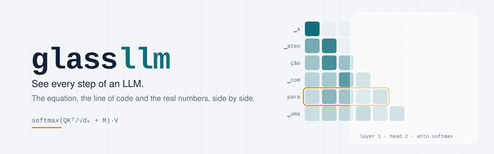
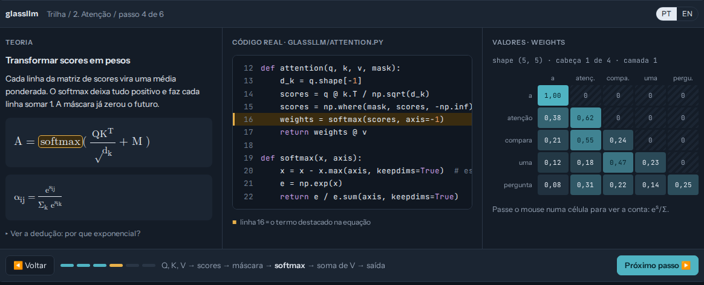
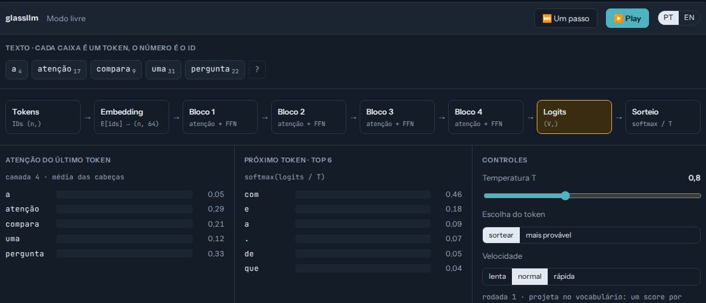
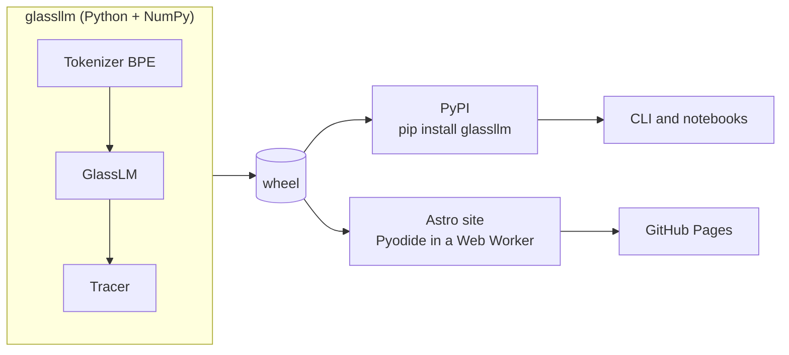
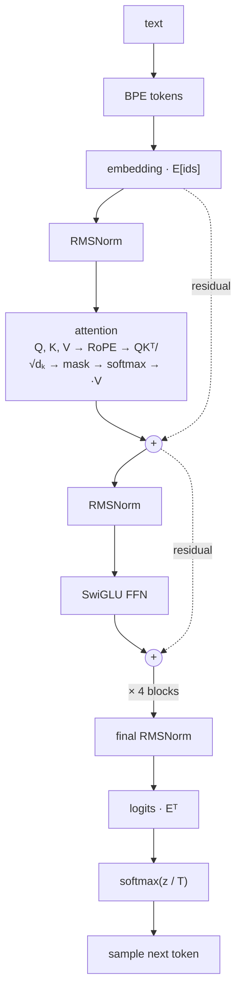

<div align="center">

<picture>
  <source media="(prefers-color-scheme: dark)" srcset="docs/assets/banner-dark.svg">
  
</picture>

**A small Transformer written from scratch in NumPy, built to be looked at.**<br>
Pick any step of the model and see the equation, the line of code that computes it,<br>
and the real numbers it produced for your sentence.

[](#roadmap)
[](LICENSE)
[](https://www.python.org/)
[](#design-principles)
[](CONTRIBUTING.md)

**English** · [Português](README.pt-BR.md)

</div>

---

> [!NOTE]
> **glassllm is under construction.** This README describes the project being built.
> Items marked as *planned* do not exist yet. Follow the [roadmap](#roadmap) to see what has landed.

## Why

Most explanations of LLMs stop at diagrams, and most real code hides the math behind
`torch.nn` and autograd. You end up knowing the words without seeing the machine run.

glassllm closes that gap. Every computation in the model is tagged, recorded and linked to
its equation, so you can follow a single token from text to prediction and check every
number along the way.

## What you get

| | |
|---|---|
| **A Python library** (`pip install glassllm`, *planned*) | A complete decoder-only Transformer in NumPy: BPE tokenizer, a tiny autograd engine, RoPE, grouped-query attention, SwiGLU, RMSNorm and a KV cache. Pretrained Portuguese and English models ship inside the package. |
| **A trace mode** | Pass a `Tracer` to the model and every tagged step is recorded with its layer, head, shape and value. |
| **A command line tool** | Tokenize, generate and print any step of the computation from the terminal. |
| **An interactive site** (*planned*) | Eleven chapters that walk through the model, plus a free mode that generates text token by token in a loop. Runs the same library in your browser with Pyodide. Nothing to install. |

## Preview

Design mockups. The numbers are illustrative; the real site computes them with the model.

**Chapter screen.** Theory, real code and values side by side. The highlighted term in the
equation, the highlighted line of code and the matrix all refer to the same step.



**Free mode.** Type a prompt, press play, and watch each token travel through the model,
get a probability and join the text.



## How it works

One core library feeds both the terminal and the browser.



Inside the model, a token goes through these steps. Each one is a tagged step you can inspect.



### Trace mode

Each step is marked in the source with a comment, and the tracer records the value when the
model runs. *Planned API:*

```python
from glassllm import load_pretrained, Tracer

model, tokenizer = load_pretrained("en")
ids = tokenizer.encode("Alice was beginning to")

tracer = Tracer()
model.forward(ids, trace=tracer)

step = tracer.get("attn.softmax", layer=0, head=1)
print(step.equation)   # softmax(QKᵀ/√dₖ + M)
print(step.value)      # the (n, n) attention weights for this sentence
```

```python
# glassllm/nn.py
weights = softmax(scores, axis=-1)  # @step attn.softmax
```

## The learning path

| # | Chapter | You will see |
|---|---|---|
| 0 | Overview | The whole flow, from text to the next token |
| 1 | BPE tokenization | How merges turn text into tokens |
| 2 | Embedding | Token IDs becoming vectors |
| 3 | Attention | Q, K, V, scores, softmax and the weighted mix |
| 4 | Causal mask | Why the future gets weight zero |
| 5 | RoPE | Rotations that encode relative position |
| 6 | Multi-head and GQA | Heads side by side, shared K and V |
| 7 | Residual and RMSNorm | The residual stream and why pre-norm |
| 8 | SwiGLU FFN | The gated per-token network |
| 9 | Logits, loss and training | Cross-entropy, the `p − y` gradient, a live mini training run |
| 10 | Generation loop and KV cache | Sampling, temperature and caching |

The full derivations, in Portuguese, are already in [docs/equacoes.md](docs/equacoes.md).

## Roadmap

- [x] Design spec ([docs/specs](docs/specs/2026-10-10-glassllm-design.md))
- [x] Equations and derivations ([docs/equacoes.md](docs/equacoes.md))
- [ ] **Phase 1: library.** Tokenizer, autograd, model, tracer, training, CLI, pretrained PT and EN models, tests against PyTorch
- [ ] **Phase 2: site and free mode.** Astro, Pyodide worker, generation loop, deploy to GitHub Pages
- [ ] **Phase 3: chapters.** Chapters 0 to 10 in English and Portuguese

## Design principles

- **Nothing hidden.** Runtime depends on NumPy only. Gradients come from a small autograd
  engine you can read in one sitting.
- **Verified, not approximate.** Every layer is tested against a PyTorch reference, forward
  and backward.
- **Small on purpose.** About 0.9M parameters, so it runs in a browser tab. The goal is to
  understand, not to write good prose.
- **One source of truth.** The site runs the same wheel that is published on PyPI.
- **Two languages.** Interface and chapters in English and Portuguese.

## Repository layout

```
glassllm/
├── src/glassllm/      the library (planned)
├── tests/             tests, including PyTorch parity (planned)
├── scripts/           corpus, tokenizer and model training (planned)
├── site/              Astro site (planned)
└── docs/
    ├── equacoes.md    equations and derivations (PT)
    ├── specs/         design documents
    ├── prototipo/     the original PyTorch prototype
    └── assets/        images used in this README
```

## Contributing

Contributions are welcome, and you do not need to be an ML expert to help. Useful places to
start:

- **Explanations.** Clearer wording, better intuitions, fixes in the derivations.
- **Translations.** Every chapter exists in English and Portuguese.
- **Tests.** More parity checks and edge cases.
- **Visuals.** Better ways to show a matrix, a rotation or a gradient.

Read [CONTRIBUTING.md](CONTRIBUTING.md) before opening a pull request, and follow the
[Code of Conduct](CODE_OF_CONDUCT.md).

## Acknowledgements

glassllm builds on ideas from these works:

- Vaswani et al., [*Attention Is All You Need*](https://arxiv.org/abs/1706.03762), 2017.
- Su et al., [*RoFormer: Enhanced Transformer with Rotary Position Embedding*](https://arxiv.org/abs/2104.09864), 2021.
- Shazeer, [*GLU Variants Improve Transformer*](https://arxiv.org/abs/2002.05202), 2020.
- Zhang and Sennrich, [*Root Mean Square Layer Normalization*](https://arxiv.org/abs/1910.07467), 2019.
- Ainslie et al., [*GQA: Training Generalized Multi-Query Transformer Models*](https://arxiv.org/abs/2305.13245), 2023.
- Sennrich et al., [*Neural Machine Translation of Rare Words with Subword Units*](https://arxiv.org/abs/1508.07909), 2016.
- Kudo and Richardson, [*SentencePiece*](https://arxiv.org/abs/1808.06226), 2018.
- Andrej Karpathy's [micrograd](https://github.com/karpathy/micrograd) and [nanoGPT](https://github.com/karpathy/nanoGPT), for showing how much fits in a small, readable codebase.

Training text comes from public domain books on [Project Gutenberg](https://www.gutenberg.org/):
*Dom Casmurro* by Machado de Assis and *Alice's Adventures in Wonderland* by Lewis Carroll.

## License

Code under the [MIT License](LICENSE). Chapter texts under
[CC BY 4.0](https://creativecommons.org/licenses/by/4.0/).
