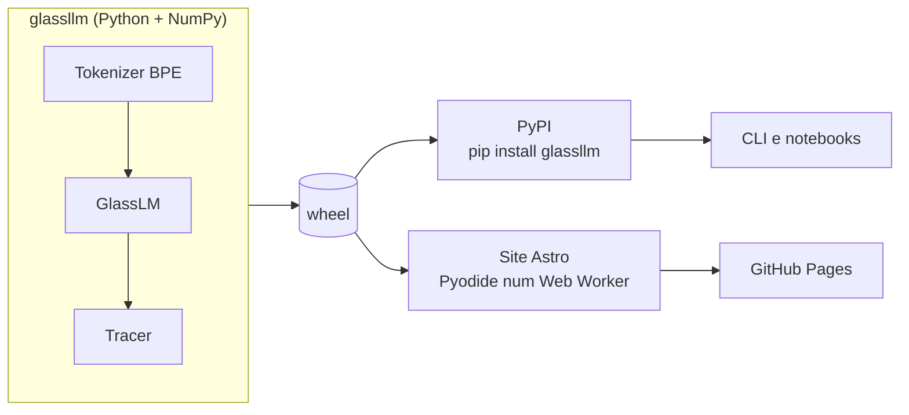
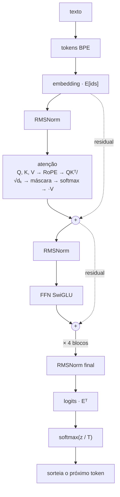

<div align="center">

<picture>
  <source media="(prefers-color-scheme: dark)" srcset="https://raw.githubusercontent.com/Oseiasdfarias/glassllm/develop/docs/assets/banner-dark.svg">
  
</picture>

**Um Transformer pequeno, escrito do zero em NumPy, feito para ser olhado por dentro.**<br>
Escolha qualquer passo do modelo e veja a equação, a linha de código que a calcula<br>
e os números de verdade que ela produziu para a sua frase.

[](#roteiro)
[](LICENSE)
[](https://www.python.org/)
[](#princípios)
[](CONTRIBUTING.md)

[English](README.md) · **Português**

</div>

---

> [!NOTE]
> **As Fases 1 e 2 estão implementadas e validadas localmente.** O site bilíngue em Astro executa a
> biblioteca e os modelos treinados num worker Pyodide. O fluxo de publicação no PyPI está configurado;
> falta cadastrar o Trusted Publisher no PyPI. A publicação no GitHub Pages e a trilha de capítulos
> continuam pendentes.

## Por quê

A maioria das explicações sobre LLM para nos diagramas, e a maioria do código real esconde a
matemática atrás do `torch.nn` e do autograd. A pessoa aprende os nomes sem ver a máquina
funcionando.

O glassllm fecha essa distância. Cada conta do modelo é marcada, gravada e ligada à sua
equação. Dá para seguir um token do texto até a previsão e conferir cada número no caminho.

## O que você ganha

| | |
|---|---|
| **Uma lib Python** (código-fonte neste repositório) | Tokenizer NumPy, motor de autograd, Transformer decoder, rastreamento, treino, CLI e modelos treinados em português e inglês. A primeira publicação por tag no PyPI está pendente. |
| **Um modo de depuração** | Passe um `Tracer` para o modelo e cada passo marcado é gravado com camada, cabeça, formato e valor. |
| **Uma ferramenta de terminal** | Tokenizar texto, consultar os passos do modelo, gerar texto e inspecionar valores com os assets PT/EN incluídos. |
| **Um site interativo** | Laboratório PT/EN com geração real, atenção, probabilidades e a arquitetura completa do Transformer. O desenho permite ampliar, reproduzir os 77 cálculos de cada previsão e inspecionar equações, matrizes e código. Roda num worker Pyodide; os capítulos ficam para a Fase 3. |

## Começo rápido

No checkout do repositório, instale o ambiente de desenvolvimento e rode um dos modelos:

```bash
uv sync
uv run glassllm --lang pt generate "Capitu olhou para" --n 40
uv run glassllm --lang en generate "Alice was beginning to" --n 40
uv run glassllm steps
```

## Rodar o site

Com Node.js 22.12+ e `uv` instalados:

```bash
cd site
npm ci
npm run dev
```

A primeira execução gera o wheel Python usado pelo laboratório no navegador. Ao iniciar a geração,
o painel baixa o runtime Pyodide fixado e o wheel.

No laboratório, abra **Ver rede completa**. O mapa mostra os quatro blocos com Q/K/V, RoPE,
GQA, cache K/V, máscara causal, resíduos e SwiGLU. Gere um token e clique numa operação
para ver seu tensor real e a linha de código correspondente; o seletor de cabeça permite
comparar as cabeças de atenção. **Reproduzir fluxo** e **Próximo cálculo** percorrem a ordem
registrada pelo modelo. Zoom, navegação por bloco e tela cheia ajudam a explorar o desenho.

Ative **Slow motion** para acompanhar uma operação por vez, com explicação, equação e
valores. O tempo de leitura varia de 1 a 8 segundos por cálculo (3 segundos por padrão).
**Pausar fluxo**, **Continuar**, **Cálculo anterior** e **Próximo cálculo** permitem estudar
no seu ritmo. O desenho acompanha a etapa atual; desmarque **Acompanhar etapa** para mover
o mapa livremente. Ao retomar a geração, o fluxo termina a previsão atual antes de gerar
outro token. Esse modo desacelera a visualização dos cálculos reais registrados pelo modelo.

O link **Documentação** abre 35 páginas completas por idioma, com fluxogramas de inferência
e treino, explicações da interface, fundamentos, referência da API, exemplos e bibliografia
BibTeX. São 34 prints reais dos componentes e estados de execução. Para regenerar os prints, mantenha
o servidor ativo e rode `npm run capture:docs` dentro de `site/`, com Node.js 24 e Chrome.
Use `GLASSLLM_CAPTURE_URL` se o servidor estiver em outra porta; a padrão é 4322.

## Prévia

As imagens de capítulos e do modo livre abaixo são esboços de design. O site atual já tem visão
geral bilíngue e laboratório de geração; a experiência por capítulos fica para a Fase 3.

**Tela de capítulo.** Teoria, código real e valores lado a lado. O termo destacado na
equação, a linha destacada no código e a matriz falam do mesmo passo.


**Modo livre.** Digite um começo de frase, aperte play e veja cada token atravessar o
modelo, receber uma probabilidade e entrar no texto.


## Como funciona

Uma lib central alimenta o terminal e o navegador.



Dentro do modelo, um token passa por estes passos. Cada um é um passo marcado que dá para
inspecionar.



### Modo de depuração

Cada passo é marcado no código com um comentário, e o tracer grava o valor quando o modelo
roda. Exemplo:

```python
from glassllm import load_pretrained, Tracer

model, tokenizer = load_pretrained("pt")
ids = tokenizer.encode("Capitu olhou para")

tracer = Tracer()
model.forward(ids, trace=tracer)

step = tracer.get("attn.softmax", layer=0, head=1)
print(step.equation)   # softmax(QKᵀ/√dₖ + M)
print(step.value)      # os pesos de atenção (n, n) desta frase
```

```python
# glassllm/nn.py
weights = softmax(scores, axis=-1)  # @step attn.softmax
```

## A trilha

| # | Capítulo | O que você vê |
|---|---|---|
| 0 | Visão geral | O fluxo inteiro, do texto ao próximo token |
| 1 | Tokenização BPE | Como as fusões transformam texto em tokens |
| 2 | Embedding | IDs virando vetores |
| 3 | Atenção | Q, K, V, scores, softmax e a mistura ponderada |
| 4 | Máscara causal | Por que o futuro recebe peso zero |
| 5 | RoPE | Rotações que codificam a posição relativa |
| 6 | Multi-head e GQA | Cabeças lado a lado, K e V compartilhados |
| 7 | Residual e RMSNorm | O fluxo residual e por que pre-norm |
| 8 | FFN SwiGLU | A rede com portão aplicada a cada token |
| 9 | Logits, perda e treino | Entropia cruzada, o gradiente `p − y`, um treino curto ao vivo |
| 10 | Geração em loop e KV cache | Sorteio, temperatura e cache |

As deduções completas já estão em [docs/equacoes.md](docs/equacoes.md).

## Roteiro

- [x] Spec de design ([docs/specs](docs/specs/2026-10-10-glassllm-design.md))
- [x] Equações e deduções ([docs/equacoes.md](docs/equacoes.md))
- [x] **Fase 1: lib.** Corpora e modelos PT/EN foram gerados; testes passam no Python 3.10 e 3.13; o wheel foi instalado e testado fora do checkout. O fluxo do PyPI está configurado; falta cadastrar o Trusted Publisher e criar uma tag de release.
- [x] **Fase 2: site e modo livre.** Astro, páginas PT/EN, worker Pyodide, geração em loop e build local
- [ ] **Deploy da Fase 2.** Publicar no GitHub Pages a partir da `main`
- [ ] **Fase 3: capítulos.** Do 0 ao 10, em português e inglês

## Princípios

- **Nada escondido.** Em execução, só depende do NumPy. Os gradientes vêm de um motor de
  autograd pequeno, que dá para ler de uma vez.
- **Conferido, não aproximado.** Cada camada é testada contra uma referência em PyTorch, na
  ida e na volta.
- **Pequeno de propósito.** Cerca de 0,9 milhão de parâmetros, para rodar numa aba do
  navegador. O objetivo é entender, não escrever bem.
- **Uma fonte de verdade.** O site roda o wheel construído a partir da mesma biblioteca Python.
- **Dois idiomas.** Interface e capítulos em português e inglês.

## Estrutura do repositório

```
glassllm/
├── src/glassllm/      implementação da lib
├── tests/             testes, incluindo paridade com PyTorch
├── scripts/           corpus, tokenizer e treino do modelo
├── site/              site Astro bilíngue e laboratório livre em Pyodide
└── docs/
    ├── equacoes.md    equações e deduções
    ├── specs/         documentos de design
    ├── prototipo/     o protótipo original em PyTorch
    └── assets/        imagens deste README
```

## Como contribuir

Contribuições são bem-vindas, e não precisa ser especialista em ML para ajudar. Bons pontos
de partida:

- **Explicações.** Texto mais claro, intuições melhores, correções nas deduções.
- **Traduções.** Cada capítulo existe em português e inglês.
- **Testes.** Mais conferências de paridade e casos de borda.
- **Visual.** Jeitos melhores de mostrar uma matriz, uma rotação ou um gradiente.

Leia o [CONTRIBUTING.md](CONTRIBUTING.md) antes de abrir um pull request e siga o
[Código de Conduta](CODE_OF_CONDUCT.md).

## Agradecimentos

O glassllm se apoia nas ideias destes trabalhos:

- Vaswani et al., [*Attention Is All You Need*](https://arxiv.org/abs/1706.03762), 2017.
- Su et al., [*RoFormer: Enhanced Transformer with Rotary Position Embedding*](https://arxiv.org/abs/2104.09864), 2021.
- Shazeer, [*GLU Variants Improve Transformer*](https://arxiv.org/abs/2002.05202), 2020.
- Zhang e Sennrich, [*Root Mean Square Layer Normalization*](https://arxiv.org/abs/1910.07467), 2019.
- Ainslie et al., [*GQA: Training Generalized Multi-Query Transformer Models*](https://arxiv.org/abs/2305.13245), 2023.
- Sennrich et al., [*Neural Machine Translation of Rare Words with Subword Units*](https://arxiv.org/abs/1508.07909), 2016.
- Kudo e Richardson, [*SentencePiece*](https://arxiv.org/abs/1808.06226), 2018.
- [micrograd](https://github.com/karpathy/micrograd) e [nanoGPT](https://github.com/karpathy/nanoGPT), de Andrej Karpathy, por mostrarem quanto cabe num código pequeno e legível.

Os textos de treino são livros em domínio público do [Projeto Gutenberg](https://www.gutenberg.org/):
romances de Machado de Assis (português) e de Lewis Carroll (inglês).

## Licença

Código sob a [Licença MIT](LICENSE). Textos dos capítulos sob
[CC BY 4.0](https://creativecommons.org/licenses/by/4.0/deed.pt_BR).
